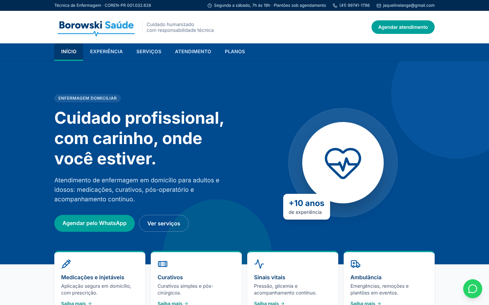
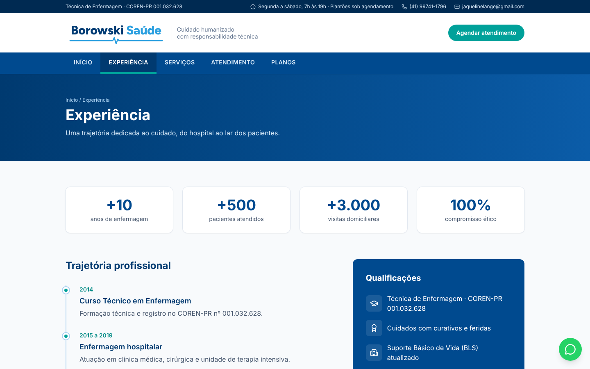
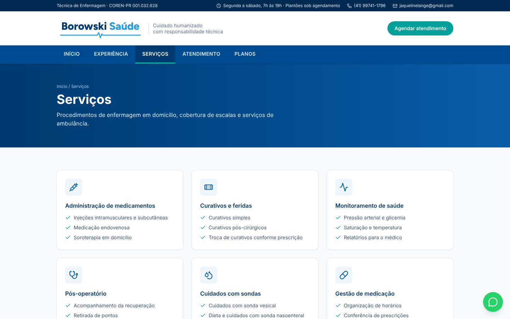
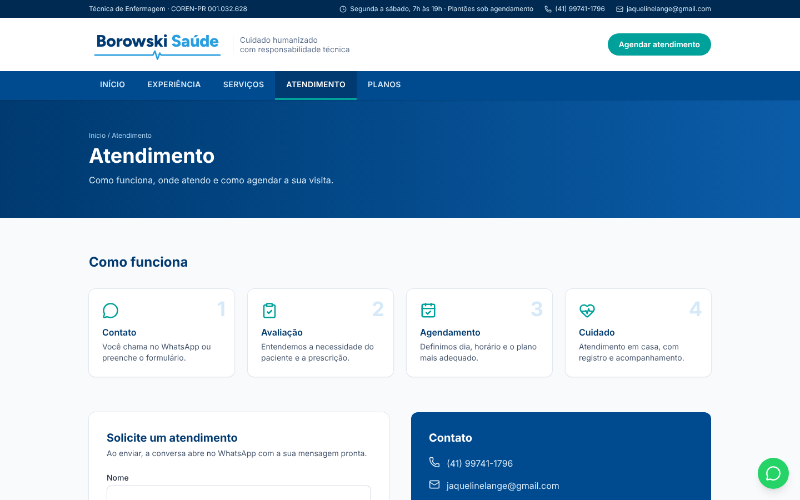
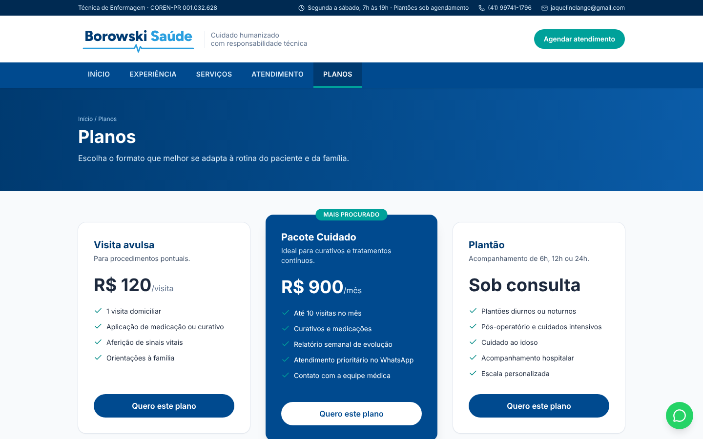
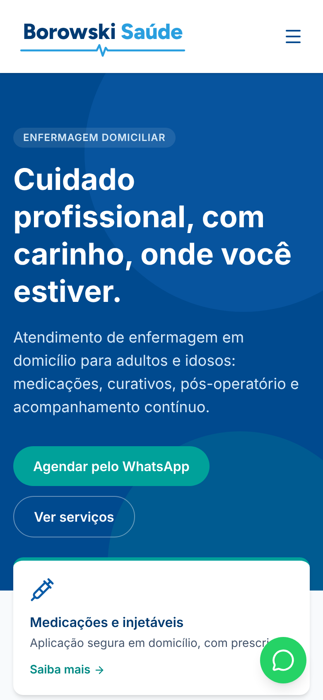
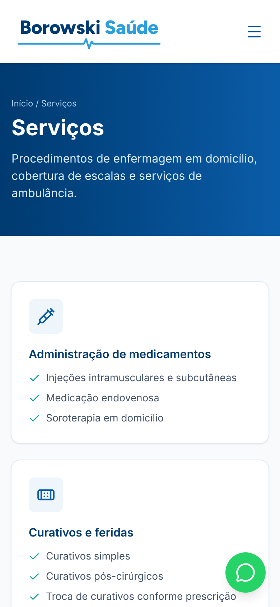
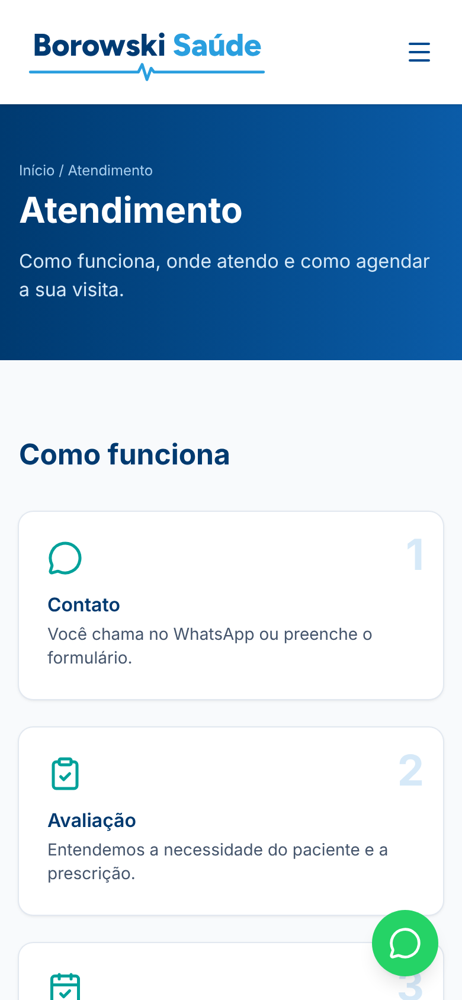

<p align="center">
  
</p>

<h1 align="center">Borowski Saúde — nursing care website</h1>

<p align="center">
  Website of <strong>Borowski Saúde</strong>, a home nursing and ambulance service in Curitiba, Brazil, and the surrounding area,
  run by Nursing Technician Jaqueline (COREN-PR 001.032.628).<br />
  README available in Portuguese, English and Spanish.
</p>

<p align="center">
  <a href="README.md">Português</a> · <strong>English</strong> · <a href="README.es.md">Español</a>
</p>

<p align="center">
  
  
  
  
</p>



## About the project

This repository contains the Borowski Saúde website. Its goal is to present home nursing
care and ambulance services in a clear and trustworthy way, show the professional's
experience, and make it easy to book an appointment over WhatsApp.

The look was inspired by institutional health portals, with shades of blue, quick-access
cards and tab navigation.

The website itself is in Portuguese, since it serves patients in Brazil.

### Goals

- Present the home nursing and ambulance services in just a few pages.
- Build trust, with the COREN registration (the regional nursing council license) visible
  across the site.
- Show the care plans in a simple way.
- Take the visitor to WhatsApp in a few clicks.

## Features

- **Five tabs:** Início (Home), Experiência (Experience), Serviços (Services), Atendimento
  (Booking) and Planos (Plans), navigated through links (`#inicio`, `#servicos` etc.)
  without reloading the page.
- **Nursing services:** medication, wound dressings, health monitoring, post-operative
  care, tube care, elderly care and shift coverage (gaps, vacations and absences), within
  the duties that COFEN (Brazil's Federal Nursing Council) defines for Nursing Technicians.
- **Ambulance:** medical emergencies, patient transport and standby coverage at events such
  as football matches, equestrian events, concerts and rodeos.
- **Booking form:** the visitor fills in name, phone and service, and a WhatsApp chat opens
  with the message ready to send. No server needed.
- **Floating WhatsApp button** on every page.
- **FAQ** on the Booking tab.
- **Responsive:** layout designed for desktop and mobile, with a collapsible menu.
- **Own visual identity:** dark blue `#003b73`, light blue `#2a9fdf` and teal `#00a19a`, a
  logo with a heartbeat line, and the Figtree font.

## Screens

### Desktop

| Experience | Services |
| --- | --- |
|  |  |

| Booking | Plans |
| --- | --- |
|  |  |

### Mobile

| Home | Services | Booking |
| --- | --- | --- |
|  |  |  |

## Technologies

| Technology | What it is used for |
| --- | --- |
| [Vite](https://vite.dev/) | Development server and production build |
| [React](https://react.dev/) | Interface components |
| [TypeScript](https://www.typescriptlang.org/) | Typed code that is safer to maintain |
| [Tailwind CSS](https://tailwindcss.com/) | Styles and responsive layout |
| [Lucide](https://lucide.dev/) | Icons |
| SVG | Logo and browser tab icon |

The site uses no database and no login. The production build is made only of static files
(HTML, CSS and JavaScript), which keeps the site fast, cheap to host and free of servers to
maintain. It can be published for free on Vercel, Netlify or GitHub Pages.

## Running it locally

You will need [Node.js](https://nodejs.org/) 20 or newer.

```bash
git clone https://github.com/vidaltechnologies/borowskisaude.git
cd borowskisaude
npm install
npm run dev
```

Then open http://localhost:5173.

Other commands:

| Command | What it does |
| --- | --- |
| `npm run build` | Builds the production site into `dist/` |
| `npm run build:single` | Builds the whole site into a single `index.html`, in `dist-single/` |
| `npm run preview` | Serves the production build created by `build` |
| `npm run lint` | Checks the code |

## Editing the content

| What to change | Where it lives |
| --- | --- |
| Phone, WhatsApp, email, COREN, region and hours | `src/data.ts` |
| Plan prices and items | `src/pages/Planos.tsx` |
| Career history and qualifications | `src/pages/Experiencia.tsx` |
| Services and ambulance list | `src/pages/Servicos.tsx` |
| Colors | `@theme` block in `src/index.css` |

## Code structure

```
src/
├── App.tsx                 # Switches tabs from the address (#inicio, #servicos...)
├── main.tsx                # Entry point
├── index.css               # Tailwind and theme colors
├── data.ts                 # Contact details and tab list
├── components/
│   ├── Header.tsx          # Top bar, logo and tabs
│   ├── Footer.tsx
│   ├── Logo.tsx            # Borowski Saúde logo in SVG
│   ├── PageHero.tsx        # Title band for inner pages
│   └── WhatsAppButton.tsx  # Floating WhatsApp button
└── pages/
    ├── Inicio.tsx
    ├── Experiencia.tsx
    ├── Servicos.tsx
    ├── Atendimento.tsx     # How it works, booking form and FAQ
    └── Planos.tsx
public/                     # Icons for mobile and browser
docs/                       # Logo and images used in this README
```

---

© Vidal Technologies. All rights reserved.
